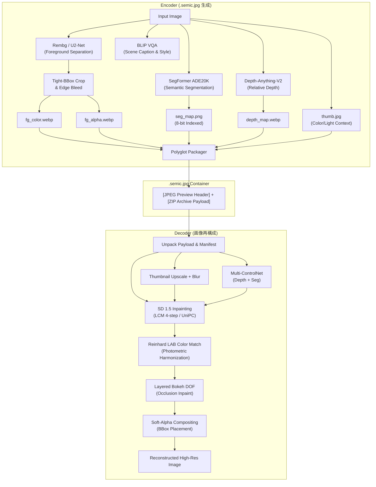

# Semantic Codec (v1.0.0 Final Research Prototype)

[](https://www.python.org/downloads/)
[](https://pytorch.org/)
[](https://github.com/huggingface/diffusers)
[](LICENSE)

> **Foreground Fidelity. Background Generativity.**  
> 人物や主要被写体などの前景領域をロスレス・高解像度で保持し、背景領域を **拡散モデル（Stable Diffusion + Multi-ControlNet）** により超低ビットレートから生成・再構成する次世代のセマンティック画像コーデック。

---

## 💡 背景とコンセプト

従来の画像圧縮規格（JPEG, WebP, AVIF）は画像全体を一律に周波数変換・量子化するため、ビットレートを極端に削減すると画像全体が均一に破綻・ぼやけます。  
一方、近年の生成画像圧縮（PerCo, DiffEIC 等）では、拡散モデルにより高知覚品質なテクスチャを復元できる反面、**「人物の顔やディテールが変わってしまう（Semantic Drift）」** という致命的課題を抱えていました。

**Semantic Codec** は、画像の空間的・意味的非対称性に着目し、以下を同時に達成するハイブリッド・コーデックです：
1. **前景 ROI の高忠実度保存**: 背景を透過分離した前景被写体のタイト外接矩形（BBox）のみを切り出し、エッジの色滲み（Color Bleed）を除去した上で WebP 符号化。
2. **背景の極限セマンティック圧縮**: BLIP による VQA プロンプト、Depth-Anything-V2 による深度マップ、SegFormer による 8-bit インデックス構造マップ（2〜5KB）、および低解像度色調サムネイルのみを保存。
3. **Polyglot コンテナ (`.semic.jpg`)**: 一般の画像ビューアでは通常の JPEG プレビューとして開き、専用デコーダでは ZIP ペイロードを展開して高解像度 AI 再構成を実行。

---

## 🔬 先行研究との比較

2024〜2026 年の拡散生成画像圧縮の主要研究との比較：

| 方式・研究 | 主なアプローチ | 前景忠実度 (Faces/Objects) | デコード速度 | 特徴・制約 |
| :--- | :--- | :--- | :--- | :--- |
| **Text+Sketch / PICS (2023)** | Canny エッジ + テキスト | 低 (エッジノイズで顔が崩壊) | 遅い (50 step) | 輪郭依存が強く、平坦部でハルシネーションが発生 |
| **PerCo (2024)** | Latent Inpainting + Mask | 中 | 遅い (30-50 step) | 前景境界に色フリンジ・ボケが発生 |
| **OneDC (NeurIPS 2025)** | Hyperprior 蒸留 + 1-step | 中〜高 (全体均一) | 極めて速い (1 step) | 前景領域の独立したピクセル忠実度保証はない |
| **StableCodec (ICCV 2025)** | Dual-Branch 極限圧縮 | 高 (<0.05 bpp) | 極めて速い (1 step) | モデルの事前学習が必要（ゼロショット適用不可） |
| **Semantic Codec (v1.0.0)** | **ROI Coding + Multi-ControlNet + LCM 4-step** | **極めて高い (ピクセル完全一致)** | **高速 (~2秒, 4 step)** | **学習済みモデルを活用したゼロショット動作、BBox空間ビット配分** |

---

## 🏗️ システムアーキテクチャ



---

## ⚡ v1.0.0 の主要新機能

1. **空間ビット配分 (ROI Tight-BBox Coding)**:
   - 前景の最小外接矩形（BBox）のみを切り出し、背景をゼロクリアすることで前景容量を **40〜80% 削減**。
2. **形態学的カラーデコンタミネーション (Edge Bleed)**:
   - 前景境界外側へ内部色を数ピクセル外挿し、WebP 不可逆圧縮時のリンギング黒ずみ・元背景ハローを根絶。
3. **8-bit インデックスパレット PNG Seg マップ**:
   - 24bit RGB ではなく ADE20K 150 クラスのパレット PNG として保存。容量を従来の 1/10（2〜6 KB）に圧縮し、クラス境界の色補間劣化をゼロ化。
4. **Turbo デコードモード (LCM-LoRA 4-Step)**:
   - 従来の 20〜50 ステップ生成をわずか **4 ステップ**（約1.5〜2.5秒）に短縮（UniPC への安全フォールバック機能付き）。
5. **Reinhard LAB 光学調和 (Photometric Harmonization)**:
   - 元画像の低周波サムネイルの色空間統計（平均・分散）を生成背景に適用し、環境光や色温度の一貫性を担保。
6. **Rate-Distortion メトリクス (bpp, PSNR, SSIM)**:
   - 符号化効率（bits per pixel）および前景/背景の再構成品質を客観的に評価・出力。

---

## 🚀 クイックスタート

### 1. インストール
```bash
git clone https://github.com/Lil4AI/SemanticCodec.git
cd SemanticCodec

python -m venv venv
# Windows:
.\venv\Scripts\activate
# Linux/macOS:
source venv/bin/activate

pip install -r requirements.txt
```

### 2. Web UI の起動
```bash
python app.py
```
ブラウザで `http://127.0.0.1:5000` を開きます。
- **Encode パネル**: 画像をドラッグ＆ドロップしてプロファイル（Lite / Standard / HighFi）を選択し、`.semic.jpg` を生成。
- **Decode パネル**: `.semic.jpg` をドロップすると即座にメタデータと Lite プレビューが表示され、Reconstruct ボタンで AI 背景再構成を実行。完了後は **Before / After 比較スライダー** で仕上がりを直感的に確認できます。

### 3. CLI (コマンドライン) での使用
```bash
# 1. エンコード (Standard モード)
python cli.py encode input.jpg --mode Standard -o output.semic.jpg

# 2. デコード (Turbo 4-Step モード)
python cli.py decode output.semic.jpg --mode Turbo -o reconstructed.jpg

# 3. コンテナのインスペクト (bpp・コンポーネント内訳・プロンプトを表示)
python cli.py inspect output.semic.jpg

# 4. レート・歪みベンチマーク (Lite / Standard / HighFi 一括評価)
python cli.py benchmark input.jpg
```

---

## 📂 プロジェクト構造

```text
SemanticCodec/
├── README.md                  # 本ドキュメント
├── requirements.txt           # 依存パッケージ定義
├── codec_engine.py            # コアコーデックエンジン (ModelManager, ROI, LAB, Metrics)
├── app.py                     # Flask Web API & SSE サーバー
├── cli.py                     # CLI ツール (encode / decode / inspect / benchmark)
├── templates/
│   └── index.html             # Web UI テンプレート (Before/After スライダー, Turbo, bpp 表示)
├── static/
│   ├── app.js                 # フロントエンドロジック (SSE 進捗, スライダー, インスペクト)
│   └── style.css              # UI スタイルシート
├── docs/
│   ├── PROJECT_RULES.md       # バージョン管理・ドキュメント作成規約
│   ├── v0.2.0/ - v0.4.1/      # 過去バージョンの設計書・タスク・仕様書
│   └── v1.0.0/                # v1.0.0 仕様書・計画書・ウォークスルー
└── loras/                     # オプション LoRA 格納ディレクトリ
```

---

## 📜 ライセンス
本プロジェクトは [MIT License](LICENSE) の下で公開されています。
