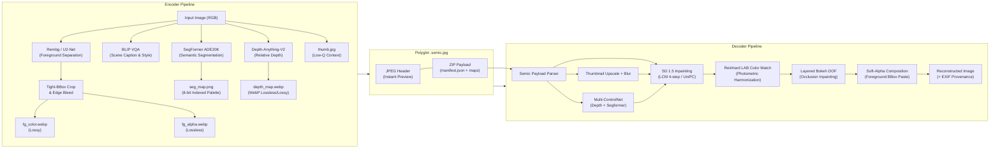

# Semantic Codec v1.0.0 (Final Research Prototype) 仕様書

## 1. 概要・システムアーキテクチャ
Semantic Codec v1.0.0 は、高周波で厳密な再構成が求められる「前景被写体」と、知覚的リアリズムと統計的一貫性が求められる「背景環境」を空間的・意味的に分離して符号化する **ROI Semantic & Generative Image Codec** である。



---

## 2. コア革新技術とアルゴリズム仕様

### 2.1 空間ビット配分 (ROI Tight-BBox Coding)
- 前景アルファマスク $\alpha \in [0, 255]$ のノイズ閾値判定（$\alpha < 8 \to 0$）を実施。
- 非ゼロ領域の外接矩形 $\text{BBox} = [x_{\min}, y_{\min}, x_{\max}, y_{\max}]$ を算出し、前景画像とアルファチャンネルをクロップ。
- 矩形内部の背景画素（$\alpha = 0$）を $(0, 0, 0)$ にゼロクリアすることで、WebPのエントロピー符号化効率を極大化（40〜80%の容量削減）。

### 2.2 形態学的カラーデコンタミネーション (Edge Bleed)
- 半透明境界領域（$0 < \alpha < 210$）および外側4pxに対し、前景内部色（$\alpha \ge 210$）を法線方向へ外挿するモルフォロジー拡散（Edge Bleed）を適用。
- デコード時はソフトアルファ合成を行うことで、WebP圧縮歪み（リンギング）や元背景のハロー（黒ずみ・色縁）を完全排除。

### 2.3 8-bit インデックスパレット PNG によるクラス境界保持
- SegFormer の出力クラスID（$0 \dots 149$）を 24-bit RGB ではなく、1チャンネルの `mode="P"` パレット PNG として保存。
- ADE20K の 150色パレットを直接アタッチすることで、ファイルサイズを従来の約 1/10（2〜6 KB）に圧縮。
- リサイズ時は常に `Image.NEAREST` を徹底し、クラス境界にパレット外の補間色（擬似クラス）が発生する問題を解消。

### 2.4 LCM-LoRA 高速デコード (Turbo Mode)
- `latent-consistency/lcm-lora-sdv1-5` と `LCMScheduler` を統合。
- 従来の 20〜50 ステップをわずか **4 ステップ**（約1.5〜2.5秒）に短縮。
- オフライン環境等で LCM-LoRA が利用不可な場合は、`UniPCMultistepScheduler` の 8 ステップへ自動フォールバック。

### 2.5 Reinhard LAB 色調・照明調和 (Photometric Harmonization)
- 生成された背景に対し、低周波サムネイルの CIE $L^*a^*b^*$ 色空間平均・分散を Reinhard 変換式で適応：
  $$C_{\text{harm}} = (1 - \alpha_{\text{lock}}) C_{\text{gen}} + \alpha_{\text{lock}} \left( \frac{\sigma_{\text{thumb}}}{\sigma_{\text{gen}} + \epsilon} (C_{\text{gen}} - \mu_{\text{gen}}) + \mu_{\text{thumb}} \right)$$
- デコード時のデフォルト Strength を `0.85` とし、元画像の環境光・色温度を厳密に保持。

### 2.6 光学的被写界深度 (Pyramid Bokeh + Inpainting)
- ボケ処理前に前景領域を周囲背景色で `cv2.inpaint` 補完。ボケ適用時に前景の色が背景側へ滲み出るアーティファクトを抑制。
- 深度マップに基づき 3段階（遠景・中景・近景）のピラミッドブラーを滑らかに合成。

---

## 3. エンコードプロファイル仕様

| プロファイル | プレビュー解像度/品質 | サムネイル解像度/品質 | 前景品質 (RGB / Alpha) | 深度マップ解像度/品質 | セグメンテーション |
| :--- | :--- | :--- | :--- | :--- | :--- |
| **Lite** | 256px / Q60 | 128px / Q6 | Q72 / Lossy Q80 | 256px / Lossy Q55 | 格納なし (0 KB) |
| **Standard** | 384px / Q75 | 256px / Q8 | Q84 / Lossless | 384px / Lossy Q70 | 384px 8bit PNG (2-5 KB) |
| **HighFi** | 512px / Q82 | 256px / Q12 | Q92 / Lossless | 512px / Lossless | 512px 8bit PNG (4-8 KB) |

---

## 4. コンテナ仕様 (`manifest.json` v1.0.0 スキーマ)

```json
{
  "version": "1.0.0",
  "guide_type": "depth_seg",
  "width": 1920,
  "height": 1080,
  "has_foreground": true,
  "fg_bbox": [420, 180, 1380, 1060],
  "prompt": "the background scene shows a park bench...",
  "negative_prompt": "blurry, painting, abstract, deformed...",
  "image_style": "photo",
  "random_seed": 123456789,
  "model_version": "sd15-inpaint_multi-cn-depth-seg_v1.0",
  "encoded_mode": "Standard",
  "bpp": 0.165,
  "lora_model": "",
  "lora_scale": 1.0,
  "fg_alpha_lossless": true,
  "analysis": {
    "foreground": "rembg-u2net",
    "caption": "blip-vqa",
    "depth": "depth-anything-v2-small",
    "segmentation": "segformer-b0-ade20k"
  }
}
```
※旧バージョン（v0.1.0〜v0.4.1）の `fg_bbox` 欠落ファイルは `[0, 0, width, height]` として完全互換。
